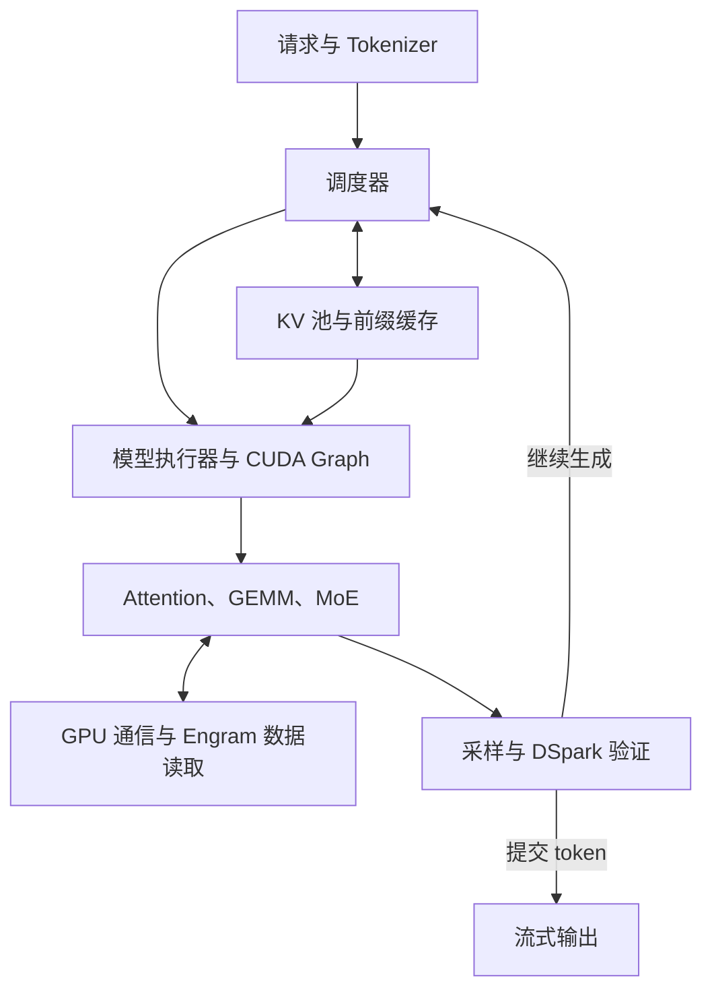

**DeepInfer 更偏向“针对 DeepSeek 自家模型和指定硬件，深度优化的推理引擎”；vLLM、SGLang 则是模型覆盖更广、在线服务能力更完整的通用推理框架。** 目前 DeepInfer 的公开版本提供离线推理，完整在线服务所需的部分缓存、分离部署和负载均衡组件尚未包含，这是选型时最大的区别。[GitHub](https://github.com/deepseek-ai/DeepInfer?utm_source=chatgpt.com)

结合你现在用 **SGLang 跑 DeepSeek-V4.1-Flash，并研究 Q/K、KV cache 和低比特精度**的工作，我的建议是：**继续用 SGLang/vLLM 承担现有部署与多模型实验，同时把 DeepInfer 作为 DeepSeek 官方实现的重点对照源码。**

下面基于 **2026 年 10 月 20 日的公开仓库、官方文档和关键源码**比较；性能部分没有做三框架同机实测。

## 一、先看整体区别

| 维度 | DeepInfer 当前开源版 | vLLM | SGLang |
|---|---|---|---|
| 主要定位 | DeepSeek 模型的专用高性能推理实现 | 通用模型推理与在线服务 | 通用模型推理与在线服务，围绕前缀缓存、调度和分布式执行持续优化 |
| 模型范围 | 官方支持列表目前只列 **DeepSeek-V4.1-Flash** | 广泛覆盖 Dense、MoE、多模态等模型 | 广泛覆盖 Dense、MoE、多模态等模型 |
| 直接交付的使用方式 | **离线推理 API、核心引擎、性能与评测脚本** | 离线 API、`vllm serve` 在线服务 | 离线 API、`sglang.launch_server` 在线服务 |
| 硬件范围 | 明确列出 **NVIDIA SM100、华为 Ascend 950** | 多代 NVIDIA、AMD、CPU，以及多种硬件插件 | NVIDIA、AMD、Ascend 等多种平台 |
| 优化组织方式 | 围绕特定模型的计算、通信、精度、缓存布局和调度组合优化 | 提供通用抽象，并为不同模型与硬件选择专门实现 | 提供通用运行时，并为不同模型与硬件选择专门实现 |
| 量化定位 | 当前加载路径绑定 V4.1 的特定混合精度配方 | 支持多种量化格式与后端 | 支持多种量化格式与后端 |
| 对现有在线服务的替换成本 | 需要补齐服务系统并重新适配 | 可沿用现有服务接口和部署生态 | 可沿用现有服务接口和部署生态 |

模型、平台与服务范围依据三者官方说明；量化配方还核对了 DeepInfer 的 [HF 配置加载代码](https://github.com/deepseek-ai/DeepInfer/blob/main/deepinfer/hugging_face/config.py)。这里的“框架支持”仍需落实到具体模型、硬件、后端和版本组合。[GitHub](https://github.com/deepseek-ai/DeepInfer?utm_source=chatgpt.com)

另一个背景是：**DeepInfer 的 README 明确说明，它最初主要基于 vLLM，并参考了 SGLang 和 TensorRT-LLM。** 三者之间有技术继承和共享关系。[GitHub](https://github.com/deepseek-ai/DeepInfer/blob/main/README.md?utm_source=chatgpt.com)

## 二、最大的实际区别：开源到“哪一层”

### 1. DeepInfer 已有核心推理能力，服务系统还需接起来

从源码看，DeepInfer 已经具备模型执行、采样、调度，以及本地 KV cache 分配和布局管理。例如：

- [cache_engine.py](https://github.com/deepseek-ai/DeepInfer/blob/main/deepinfer/worker/cache_engine.py) 已有 `KVCache`、`KVCacheManager`，管理压缩 KV、SWA cache 和 Indexer cache。
- [llm_engine.py](https://github.com/deepseek-ai/DeepInfer/blob/main/deepinfer/engine/llm_engine.py) 中，`init_pd_split()`、`do_save_kvcache()`、`send_processed_prompts()` 等仍是供外部扩展的钩子。

因此，README 中“未包含完整 KV cache system”的准确理解是：**本地推理所需的 KV 管理已经存在，但把缓存存取、Prefill/Decode 交接和服务路由接成完整系统，还需要额外实现。**

这里还要区分两种负载均衡：

| 负载均衡 | 解决的问题 | DeepInfer 当前情况 |
|---|---|---|
| **MoE 专家负载均衡，EPLB** | 热门专家集中在哪些设备，怎样减少部分设备过载 | 已实现，见 [MoE 运行时代码](https://github.com/deepseek-ai/DeepInfer/blob/main/deepinfer/model_executor/models/v4_modules/mlp.py) |
| **服务副本之间的请求负载均衡** | 一个新请求应该发给哪个 Prefill/Decode 副本 | 完整服务组件尚未包含 |

vLLM 和 SGLang 已有可使用的 PD 分离方案及相应连接器或路由组件，不过仍需要部署和配置外部系统，也存在功能组合限制；vLLM 的通用 PD 文档目前仍标记为 experimental。[vLLM](https://docs.vllm.ai/en/latest/features/disagg_prefill/?utm_source=chatgpt.com)

同时开源的 **deepseek-recipe** 负责协议转换、prompt 构造、token 编解码和输出解析。它可以帮助服务保持与官方一致的请求处理逻辑，使用方仍需接入模型推理和 HTTP 传输。[deepseek-ai/deepseek-recipe · GitHub](https://github.com/deepseek-ai/deepseek-recipe?utm_source=chatgpt.com)

### 2. vLLM 和 SGLang 的缓存路线有什么区别？

这是两者长期比较中最值得保留的区别之一：

| 方面 | vLLM | SGLang |
|---|---|---|
| KV 存储与访问 | PagedAttention、分页 KV 管理 | 同样需要 KV 内存管理与分页访问能力 |
| 共享前缀的组织 | APC 使用 **基于 block 的哈希索引** | RadixAttention 使用 **Radix Tree** 组织共享前缀 |
| 更大范围的缓存复用 | 通过 Offloading、LMCache、Mooncake 等连接器扩展 | HiCache 将缓存扩展到 **GPU、CPU、存储**三个层级 |
| 跨实例复用 | 取决于外部缓存系统与连接器配置 | 取决于 L3 存储配置；L2 CPU 缓存本身是实例私有的 |

这些分别来自 vLLM APC 设计、连接器文档，以及 SGLang HiCache 设计。[vLLM](https://docs.vllm.ai/en/latest/design/prefix_caching/?utm_source=chatgpt.com)

**PagedAttention 与 RadixAttention 并不完全处在同一层：前者主要关心 KV 怎样分页存储和访问，后者主要关心共享前缀怎样组织与复用。** 所以不能据此得出“vLLM 没有前缀缓存”或者“SGLang 不需要分页”。

对实际业务而言，前缀命中率、缓存传输成本和请求路由，通常比数据结构名称更能决定收益。

## 三、DeepInfer 的优化有什么价值？哪些能力另外两家也有？

### 1. 模型、精度、算子和通信被组织成一条具体执行路径

DeepInfer 的代码把 V4.1 的模型结构与专门的运行时布局绑定得很紧。例如，其 [MoE 实现](https://github.com/deepseek-ai/DeepInfer/blob/main/deepinfer/model_executor/models/v4_modules/mlp.py) 会根据精度及通信域选择 Mega MoE 路径，并处理专家权重重排、EPLB 和共享专家融合。

这种实现最有研究价值的地方，是能看到：

> **DeepSeek 在这个模型上，实际选择了什么数据布局、什么精度、什么融合边界，以及怎样与通信和调度配合。**

vLLM、SGLang 也已经接入 DeepGEMM、DeepEP 等组件。因此，“用了 DeepSeek 的高性能 kernel”本身无法构成框架之间的决定性区别。[vLLM](https://docs.vllm.ai/en/latest/serving/expert_parallel_deployment/?utm_source=chatgpt.com)

即使底层调用同一个 GEMM 库，框架仍可能因为以下选择产生性能差异：

- 调度出来的 batch 和每个专家收到的 token 数不同；
- 输入布局、量化与反量化位置不同；
- kernel 融合边界不同；
- 通信与计算的重叠方式不同；
- CUDA Graph 捕获与执行形状不同。

这些都是比较框架时需要看的实际执行行为。

### 2. DSpark：根据预期收益决定验证多少草稿 token

DeepInfer 的 [mtp_varlen.hpp](https://github.com/deepseek-ai/DeepInfer/blob/main/csrc/engine/mtp_varlen.hpp) 展示了一个很具体的调度逻辑：

1. 读取 confidence head 对草稿 token 接受率的预测。
2. 结合启动时测得的执行耗时曲线，以及运行时反馈。
3. 选择使 **“预期接受 token 数 ÷ 本轮执行时间”** 更高的验证预算。
4. 再决定每个请求验证多少个草稿 token。

这意味着，同一个 batch 中，容易预测的请求和难预测的请求可以获得不同验证长度。置信度用于分配验证工作量，最终接受仍需经过投机解码的校验逻辑。

**但 DSpark、自适应验证已经进入另外两个框架：**

- **vLLM** 的官方 V4.1 配方已有 DSpark，NVIDIA 配方还启用了 adaptive verification；AMD 配方当前关闭该选项。[GitHub](https://github.com/vllm-project/recipes/blob/main/models/deepseek-ai/DeepSeek-V4.1-Flash.yaml?utm_source=chatgpt.com)
- **SGLang** 已实现 confidence scheduler、变长验证、相关 CUDA Graph 和调度重叠；V4.1 也有 DSpark 部署配方，但具体验证模式与 PD/CP 组合存在限制。[LMSYS Org](https://www.lmsys.org/blog/2026-07-06-dspark-sglang/?utm_source=chatgpt.com)

所以，比较时应问：**哪个版本在你的模型、硬件和并发范围内，把这套机制实现得更有效、更稳定？**

### 3. 异步调度：隐藏 CPU 开销，而非消除调度工作

DeepInfer 的 Zero-Overhead Scheduling 主要通过跨步流水，把 CPU 的调度和后处理与设备执行重叠起来。[运行时代码](https://github.com/deepseek-ai/DeepInfer/blob/main/deepinfer/worker/worker.py) 中，当前步 forward、上一轮 CPU 后处理和当前步 sampling 被交错组织。

这一方向在 SGLang 的 overlap scheduler 中也已有实现，DSpark 同样接入了该通路。[LMSYS Org](https://www.lmsys.org/blog/2026-07-06-dspark-sglang/?utm_source=chatgpt.com)

因此，值得测的是 **GPU 时间线上还剩多少空隙、每轮有多少同步和小 kernel 开销**，单看“异步”或“zero overhead”标签不够。

## 四、对你最有价值的区别：低比特配方与数值可复现性

### 1. DeepInfer 公开了 V4.1 的具体混合精度实现

我核对了 [配置加载](https://github.com/deepseek-ai/DeepInfer/blob/main/deepinfer/hugging_face/config.py)、[MoE 执行](https://github.com/deepseek-ai/DeepInfer/blob/main/deepinfer/model_executor/models/v4_modules/mlp.py)、[KV 格式定义](https://github.com/deepseek-ai/DeepInfer/blob/main/deepinfer/model_executor/layers/tilelang_ops/cache_common.py) 和 [Indexer 实现](https://github.com/deepseek-ai/DeepInfer/blob/main/deepinfer/model_executor/models/v4_modules/index_attn.py)，当前路径可以明确拆成：

| 部分 | DeepInfer 源码中能确认的格式 |
|---|---|
| **MoE 路由专家** | 运行时采用 FP8 激活 × FP4 专家权重，专家权重为 MXFP4 路径 |
| **主压缩 KV，默认 FP4 路径** | E2M1 数据，每 **16** 个元素共享一个 **E4M3 scale** |
| **SWA KV** | E4M3 数据，每 **32** 个元素共享一个 **UE8M0 scale** |
| **Indexer Q/K** | FP4 E2M1，每 **32** 个元素共享一个 **UE8M0 scale** |

HF 加载器还明确检查 `quant_method=fp8`、`expert_dtype=fp4`、`weight_block_size=[32,32]`、`scale_fmt=ue8m0` 等配置。这体现了当前公开实现的模型专用性。

对比之下，vLLM/SGLang 提供的是更广泛的量化接入和后端选择。例如 vLLM 的 ModelOpt 接入同时区分 NVFP4、W4A16_NVFP4、MXFP8；实际执行还可能因硬件而选择不同 kernel。SGLang 也提供多种量化方法和后端。[vLLM](https://docs.vllm.ai/en/latest/features/quantization/modelopt/?utm_source=chatgpt.com)

对你的研究，应该始终拆开四件事：

**checkpoint 格式 → GEMM 权重/激活格式 → KV 存储格式 → Attention 内部计算格式。**

上表也说明，**同一个模型中的 FP4 并不是一套统一布局**。主 KV 的 g16/E4M3 scale，与 Indexer、专家权重的 g32/UE8M0 scale，需要分别处理。

另外，DeepInfer 的 [Attention 代码](https://github.com/deepseek-ai/DeepInfer/blob/main/deepinfer/model_executor/models/v4_modules/attn.py) 有很强的融合：某些分支把 Q 的 Norm、RoPE 留给后续融合 kernel 执行。**你要插 Q/K 伪量化时，仍需沿实际分支确认插入点，不能只根据 Python 变量名或 tensor dtype 判断。**

### 2. Batch invariance 对精度实验很有用，而且要按具体模型比较

Batch invariance 关注的是：**同一个请求，与不同请求组成 batch 后，计算结果是否保持一致。** 这比固定随机种子更深入，因为 batch 变化可能改变 kernel 的归约方式和数值结果。[SGLang Documentation](https://docs.sglang.io/docs/advanced_features/deterministic_inference?utm_source=chatgpt.com)

三者当前情况有一个值得注意的区别：

| 框架 | 已核实的情况 |
|---|---|
| **DeepInfer** | 明确提供 NVIDIA 路径的 batch-invariant inference；[运行时配置](https://github.com/deepseek-ai/DeepInfer/blob/main/deepinfer/worker/runtime_config.py) 会切换 DeepGEMM、TileKernels 的确定性算法 |
| **vLLM** | 有 `VLLM_BATCH_INVARIANT=1`，目前标为 beta；官方已验证模型列表本身不足以证明 V4.1 路径也可用 |
| **SGLang** | 有通用确定性推理功能，但当前 **V4.1 官方说明明确指出该后端不接受 `--enable-deterministic-inference`** |

这里必须区分“框架有这个功能”和“你正在跑的模型后端支持这个功能”。[vLLM](https://docs.vllm.ai/en/latest/features/batch_invariance/?utm_source=chatgpt.com)

DeepInfer 要进一步获得确定性采样，官方要求开启 BII、关闭变长验证，并固定 `SamplingParams.seq_seed`：

```text
DEEPINFER_BATCH_INVARIANT=1
DEEPINFER_ENABLE_MTP_VARLEN=0
固定 seq_seed
```

这些条件适用于其公开支持的 NVIDIA 路径。[GitHub](https://github.com/deepseek-ai/DeepInfer/blob/main/README.md?utm_source=chatgpt.com)

**对你的价值是减少 batch 变化造成的干扰，让量化误差更容易归因。** 它不承诺与其他框架、其他 GPU/NPU 或不同版本逐 bit 一致。

还有一个容易影响精度对照的开关：**SWA bounded replay**。SGLang 的 V4.1 文档明确说明，它与完整 prefill 并非数值等价；所以做跨框架对齐时，也要检查这个开关，不能把所有差异都归因于 FP4/FP8。[SGLang Documentation](https://docs.sglang.io/cookbook/autoregressive/DeepSeek/DeepSeek-V4_1?utm_source=chatgpt.com)

## 五、性能上能不能说 DeepInfer 更快？

**当前公开材料不足以给三者排一个普遍适用的快慢顺序。**

DeepInfer README 展示的性能测试，Prefill 使用 **4 块 SM100**，Decode 使用 **64 块 SM100**，各自在一个 scale-up domain 内。这与单机、双机或者跨节点 RoCE 部署的条件明显不同。[GitHub](https://github.com/deepseek-ai/DeepInfer?utm_source=chatgpt.com)

我检查 benchmark 后发现，还要特别留意两个口径：

### 第一，测的是分阶段稳态性能

其示例把 Prefill、Decode 分开测量，并控制 warmup、profiler 和日志的干扰。这适合研究引擎效率，但不能直接等同于包含排队、路由、缓存传输和流式输出的在线服务性能。[GitHub](https://github.com/deepseek-ai/DeepInfer/blob/main/examples/README.md?utm_source=chatgpt.com)

### 第二，草稿 token 的计数可能是折算值

官方 benchmark 文档明确写出：原始 decode throughput 按 **所有草稿均被接受**的口径计数。

例如，每轮生成 5 个草稿时，满接受口径按每请求每轮 `1+5=6` 个 token 计算；真实请求如果只接受其中 3 个草稿，实际推进的 token 数就不同。[GitHub](https://github.com/deepseek-ai/DeepInfer/blob/main/examples/README.md?utm_source=chatgpt.com)

其 [绘图脚本](https://github.com/deepseek-ai/DeepInfer/blob/main/examples/sweep/plot_pareto.py) 还允许传入一个接受率，用：

\[
\tau = 1 + \text{草稿长度}\times\text{指定接受率}
\]

折算每轮 token 数。因此，比较图表前必须确认接受率是实测、模拟还是外部指定。

对你而言，一次有意义的比较至少需要固定：

- **同一 checkpoint revision**，以及相同的输入 token、输入输出长度分布。
- **相同精度配置**，包括 KV、SWA replay 和确定性选项。
- **相同 GPU 数量与互联条件**。
- **相同投机解码策略**，按实际接受并输出的 token 统计。
- 同时看 **TTFT、TPOT/ITL、尾延迟，以及满足延迟要求时的吞吐量**。

仅凭引擎峰值 tok/s，很难判断迁移后你实际使用的服务会不会更快。

## 六、结合你的工作，怎么选

| 你的目标 | 我的建议 |
|---|---|
| 继续部署 DeepSeek-V4.1，跑现有评测 | 保留当前 SGLang 主线，同时用 vLLM 做必要的交叉验证 |
| 比较 GLM、MiniMax、Nemotron、DeepSeek 等不同模型的低比特行为 | 继续以 vLLM/SGLang 为主要实验平台，模型与量化接入范围更合适 |
| 弄清楚 DeepSeek 原厂怎样组织 FP4/FP8、Indexer、KV 和融合算子 | **重点读 DeepInfer**，它给出了非常直接的实现依据 |
| 研究 MoE 大规模 EP、EPLB、通信计算融合、DSpark 调度 | 将 DeepInfer 纳入核心研究对象，并在匹配的硬件拓扑上验证 |
| 希望换个框架就让现有单机/双机服务显著提速 | 先做同条件 benchmark，再决定迁移；当前资料不能保证这个收益 |

还有两点与你最近的问题直接相关：

**硬件兼容性要看具体 SM。** B200/GB200 是 SM100；RTX 5080 是 SM120，DGX Spark 的 GB10 是 SM121。后两者没有落在 DeepInfer 当前明确列出的 SM100 支持范围内，不能因为都属于 Blackwell 就直接外推兼容性。[NVIDIA Developer](https://developer.nvidia.com/cuda/gpus?utm_source=chatgpt.com)

**最新文档也不能直接等同于你安装的 SGLang v0.5.21。** 当前 V4.1 cookbook 中的部分配方基于更新构建，使用 DSpark、PD、HiCache 等组合时，需要按实际版本和启动日志核实。[SGLang Documentation](https://docs.sglang.io/cookbook/autoregressive/DeepSeek/DeepSeek-V4_1?utm_source=chatgpt.com)

我会优先把 DeepInfer 用在你眼下最需要的事情上：**以官方实现确认 V4.1 的真实数值路径，再回到你正在使用的 SGLang 分支，逐项检查量化位置、融合顺序、KV 布局和调度行为。** 这比立即更换整个服务框架，更容易形成可解释、可复现的研究结果。


我核对了两边的 release、近期 PR 和当前源码。**最重要的结论是：SGLang 和 vLLM 保留了各自的服务框架，吸收 DeepSeek 的高性能算子、模型执行方式，再改造自己框架中与之配套的调度、缓存和通信路径。**因此，“接入了 DeepInfer 的优化”不等于“整个推理过程已经和 DeepInfer 相同”。

这次提速涉及三种不同层次：

1. **换算子或扩大融合范围**：MegaAttention、MegaMoE、MegaGate、Mega-mHC、DeepSelect。
2. **减少模型实际需要执行的工作**：SWA bounded replay、DSpark。
3. **减少算子之间的开销**：CUDA Graph、metadata 准备、Engram 数据读取、专家负载均衡、CPU 同步。

下面按你希望的顺序讲：**宏观框架 → SGLang 与 vLLM 原来的区别 → 最近升级了什么 → SGLang 与 DeepInfer 的 kernel 差异 → 对你 4×B200 的意义。**

范围以 **DeepSeek-V4.1-Flash、NVIDIA Blackwell 路径**为主，版本核验截至 **2026 年 10 月 30 日**。

---

## 一、先从宏观看：推理框架到底包含哪些东西？

可以把一次在线推理理解为下面这个循环。图中是逻辑职责，不代表每个方框都是一个独立进程。



这些层解决的问题不同：

| 层次 | 核心问题 | 典型内容 |
|---|---|---|
| 服务层 | 请求怎么进来，结果怎么出去？ | API、tokenizer、流式输出、工具调用格式 |
| 调度层 | 这一轮让哪些请求跑、各跑多少 token？ | Continuous batching、prefill/decode 调度、抢占、DP 请求分配 |
| 缓存层 | 哪些 token 已经计算过，KV 放在哪里？ | 前缀复用、KV 分页、GPU/CPU 分层缓存、P/D 传输 |
| 模型执行层 | 这一轮怎样组织模型计算？ | 模型 forward、metadata、CUDA Graph、DSpark draft/verify、SWA replay |
| 算子与通信层 | 具体计算和数据移动怎么高效完成？ | FlashMLA、DeepGEMM、FlashInfer、DeepEP、DeepSelect |

SGLang 和 vLLM 都覆盖上面的大部分职责。vLLM 当前的架构也是 API 服务、EngineCore、scheduler、KV 管理、worker/model runner 等组件协作，而不是一个 PagedAttention kernel 就构成了整个框架。[GitHub](https://github.com/vllm-project/vllm/blob/main/docs/design/arch_overview.md?utm_source=chatgpt.com)

### DeepInfer 这次公开的东西主要在哪里？

DeepInfer 公开版的重点是**高性能模型执行引擎及其配套算子、采样、并行和调度实现**。它的 README 明确列出：完整服务所需的 KV cache 系统、P/D 服务拆分、跨 DP 副本负载均衡等，并没有全部包含在这次发布中。

这里的“没有完整 KV cache 系统”，不能理解为它推理时没有 KV：它当然维护模型 forward 所需的 KV 和缓存位置，只是公开版没有把完整在线服务的缓存系统一并交付。参见 [DeepInfer README](https://github.com/deepseek-ai/DeepInfer/blob/553741557a57df44a46fb3ab72b6aafeaf945337/README.md)。

所以这次 SGLang/vLLM 的主要工作是：

> **把 DeepSeek 优化过的模型执行部件，接入自身已有的请求调度、KV 管理和在线服务体系，并把部件之间的衔接开销继续压低。**

还有一个历史关系值得知道：DeepInfer README 说明，它最初主要建立在 vLLM 之上，也借鉴了 SGLang 和 TensorRT-LLM。技术流动本来就是双向的。

---

## 二、SGLang 原来是什么框架？和 vLLM 的区别是什么？

### 2.1 SGLang 的“语言”和“运行时”要分开理解

SGLang 最初包含两个相互配合的部分：

- **前端编程接口**：方便组织多轮生成、分支、约束输出等 LLM 程序。
- **SGLang Runtime，简称 SRT**：实际负责请求调度、KV cache、模型执行和 GPU 算子。

你通过 `sglang.launch_server` 部署模型，主要接触的是后者。原始论文的核心贡献之一，是通过 **RadixAttention 自动发现和复用请求之间的公共前缀 KV**。[arxiv.org](https://arxiv.org/html/2312.07104v2?utm_source=chatgpt.com)

### 2.2 RadixAttention 和 PagedAttention，解决的问题并不完全相同

假设这些数字各代表一个 token，有两个请求：

```text
请求 A：1 2 3 4 5 6 A
请求 B：1 2 3 4 5 6 B
```

它们的公共前缀是：

```text
1 2 3 4 5 6
```

如果这段前缀的 KV 已经算过，那么处理请求 B 时，可以复用符合缓存条件的部分，只为后面的不同内容继续计算。

**SGLang 的 RadixAttention**重点是：用 radix tree 管理和查找这些公共前缀，让不同请求、不同轮次共享已计算的 KV。

**vLLM 的 PagedAttention**最初重点是：把 KV 分成块，通过页表式寻址避免为每个请求预留连续大块显存，降低浪费并支持灵活共享。如今 vLLM 也有 Automatic Prefix Caching，采用包含父块信息的 block hash 来匹配可复用前缀，通常以完整 block 为复用单位。[arxiv.org](https://arxiv.org/abs/2309.06180?utm_source=chatgpt.com)

因此：

- Radix tree 主要回答：**哪些已有 KV 可以复用？**
- 分页 KV 主要回答：**这些 KV 怎样存放、分配和寻址？**

两者可以同时使用。SGLang 的论文也明确讨论了 radix 结构与分页 KV 的兼容性。**不能把两边理解成“SGLang 有前缀复用，vLLM 只有分页”。**[arxiv.org](https://arxiv.org/html/2312.07104v2?utm_source=chatgpt.com)

### 2.3 今天两者的差异，更集中在实现组织和默认选择

| 维度 | SGLang | vLLM |
|---|---|---|
| 最初比较突出的方向 | 结构化 LLM 程序、RadixAttention、前缀复用 | PagedAttention、KV 内存效率、高吞吐服务 |
| 当前请求执行核心 | SRT scheduler、model worker、model runner | EngineCore scheduler、executor/worker、model runner |
| 前缀缓存索引 | Radix 系列缓存结构 | Block hash 系列前缀缓存结构 |
| Batch 调度 | 连续 batching、chunked prefill、CPU/GPU overlap 等 | 连续 batching、按 token 预算调度、chunked prefill、异步执行等 |
| GPU 计算 | 按模型、硬件和配置选择后端 | 同样按模型、硬件和配置选择后端 |
| 目前影响性能的主要差别 | 模型专用路径、metadata、graph、缓存和通信组织、默认后端 | 同样是这些具体实现，而非单一架构标签 |

上表的运行时组织可对应到 [SGLang scheduler](https://github.com/sgl-project/sglang/blob/e337bb10b5e1ef4a4753180fe023b2fd5925f54f/python/sglang/srt/managers/scheduler.py) 和 vLLM 的架构说明。[GitHub](https://github.com/vllm-project/vllm/blob/main/docs/design/arch_overview.md?utm_source=chatgpt.com)

另一个常见误解是：SGLang 的 CPU/GPU 重叠调度是最近从 DeepInfer 学来的。实际上，SGLang 在 **2024 年 12 月的 v0.4** 就已经介绍了这种设计：GPU 执行第 N 步时，CPU 准备第 N+1 步，尽量隐藏调度开销。[LMSYS Org](https://lmsys.org/blog/2024-12-04-sglang-v0-4/?utm_source=chatgpt.com)

**因此，今天比较两者，应该比较某个模型、某种并行方式下的真实执行路径，而不是仅比较“RadixAttention vs PagedAttention”。**

---

## 三、先把版本边界说清楚

这次最容易混淆的是：**正式发布版、当前 main、性能文章使用的实验分支，不一定是同一份代码。**

| 项目 | 本次查到的最新正式发布版 | 本次源码比较快照 |
|---|---|---|
| SGLang | **v0.5.22**，10 月 19 日发布 | main：`e337bb10` |
| vLLM | **v0.32.0**，10 月 18 日发布 | main：`53624fc9` |
| DeepInfer | 本文按公开仓库 commit 比较 | `55374155` |

正式版信息见两边 release。[GitHub](https://github.com/sgl-project/sglang/releases/tag/v0.5.22?utm_source=chatgpt.com)

两个具体例子：

- **SGLang v0.5.22 包含 MegaAttention 底层 kernel/API 暴露，但完整的服务路径集成 #43922 不在这个 tag 中。**它虽然在正式版发布日期之前合入 main，release 分支却已经分叉。按合入日期推断“正式版一定有”，会判断错。参见 [版本与集成提交的比较](https://github.com/sgl-project/sglang/compare/a93f16f0cfcfc4f866de60fab8773cd9470895d7...v0.5.22)。[GitHub](https://github.com/sgl-project/sglang/pull/43922?utm_source=chatgpt.com)
- **vLLM v0.31 已经有 MegaAttention、MegaGate、部分 mHC/通信融合等优化。**最近文章又叠加了后续 main 和部分尚未合入的 PR，所以不能把文章中的所有效果等同于直接安装 v0.32.0。[GitHub](https://github.com/vllm-project/vllm/releases/tag/v0.31.0?utm_source=chatgpt.com)

这也说明：这批优化是持续推进的，并非所有内容都在 DeepInfer 公开后才开始移植。

---

## 四、SGLang 最近具体升级了哪些部分？

我把它们按“实际替换了什么工作”归纳成七类。

### 4.1 Attention：把连续的小操作合并到 MegaAttention

在符合条件的路径中，SGLang 接入 FlashMLA 的：

```python
fused_norm_rope_attn_rope_cast.prefill(...)
fused_norm_rope_attn_rope_cast.decode(...)
```

它把 query 侧的 norm/RoPE、attention、输出侧变换与 cast 等操作做更大范围的融合，减少中间结果写回 HBM、再次读入和独立 launch。

**这个融合并没有包含整个 attention block 的全部 projection GEMM。**Indexer/top-k、部分线性投影仍有独立执行路径。源码见 [SGLang FlashMLA wrapper](https://github.com/sgl-project/sglang/blob/e337bb10b5e1ef4a4753180fe023b2fd5925f54f/python/sglang/kernels/ops/attention/flash_mla_interface.py)。

而且，**当前 main 会根据 attention TP 宽度选择默认后端**：普通聚合服务在 attention TP>1 时，默认回到普通 `flashmla`；attention TP=1 等满足条件的路径才自动选择 `flashmla_mega`。这点对你的 TP4 实验很关键，后面展开。[GitHub](https://github.com/sgl-project/sglang/pull/46263?utm_source=chatgpt.com)

### 4.2 MoE：接入 MegaMoE，并扩大 shared expert 的融合范围

MoE 一轮通常包含：

1. Router 决定 token 去哪些专家。
2. Dispatch 把 token 送到专家所在 GPU。
3. 专家执行 GEMM、激活、GEMM。
4. Combine 汇总结果。
5. 处理 shared expert 的输出。

MegaMoE 在支持的通信域、数据类型和形状下，把 **dispatch、expert GEMM、combine** 做成更紧密的融合执行。

SGLang 近期不只接入 kernel，还补齐了 V4.1 的 DP attention、idle rank、专家维度等适配；随后又让 V4.1 的 **`[32,32]` block-FP8 shared expert** 能进入融合路径，避免 shared expert 继续单独跑一套 MLP。参见 [#43228](https://github.com/sgl-project/sglang/pull/43228)、[#44837](https://github.com/sgl-project/sglang/pull/44837)。

这里的收益来源既有计算，也有少跑一批量化、激活、相加和 GEMM launch。

### 4.3 Router 和 mHC：让上一个操作直接生成下一个操作需要的数据

这一类特别值得你看 profiler。

- **MegaGate**：把 gate GEMM、专家选择以及 routing buffer 写入等工作融合。
- **Mega-mHC**：融合部分残差混合、前后子层边界操作、RMSNorm，以及可选的 FP8 cast。
- **直接写 MegaMoE 输入**：特定 decode 路径下，Mega-mHC 可以直接生成 MegaMoE 所需的 FP8 数据和 scale，省掉后续一次独立的 pre-dispatch 量化。

参见 [MegaGate #43262](https://github.com/sgl-project/sglang/pull/43262)、[Mega-mHC 直接写输入 #46163](https://github.com/sgl-project/sglang/pull/46163)。MegaGate 的 prefill 覆盖也在后续 [#47148](https://github.com/sgl-project/sglang/pull/47148) 中扩展。

这里有一个很好的反例，能帮助你判断融合收益：

> #46163 的测试中，某类 pre-dispatch kernel 从每步 **42 次降到 3 次**，但整步仅改善约 **0.1%–0.4%**，接近测量噪声。原因之一是，能直接输出 FP8 的 Mega-mHC 变体自身也更重。

所以，**launch 数下降是证据的一部分，整步关键路径是否变短才是最终判断。**

### 4.4 Indexer：优化候选评分、top-k 和数据布局

V4.1 的稀疏 attention 需要先筛选候选 token/block。这里的开销包括：

- 计算候选分数；
- top-k；
- 把选出的索引转换成后续 attention 能消费的格式。

SGLang 当前在相应 Blackwell 路径上使用 DeepGEMM 的 indexer scoring，并可直接用 **DeepSelect 处理 BF16 logits**，同时保留 FP32 和其他 fallback。

有个默认值容易看错：当前代码中，`SGLANG_OPT_DSV41_BF16_INDEX_LOGITS` 是自动选择；**SM100 且 head weights 满足条件时，默认使用 BF16，其他路径可使用 FP32。**因此不能笼统说“SGLang 默认 FP32，DeepInfer 默认 BF16”。

源码见 [indexer scoring](https://github.com/sgl-project/sglang/blob/e337bb10b5e1ef4a4753180fe023b2fd5925f54f/python/sglang/srt/layers/attention/dsv4/v41_indexer/scoring.py) 和 [环境变量定义](https://github.com/sgl-project/sglang/blob/e337bb10b5e1ef4a4753180fe023b2fd5925f54f/python/sglang/srt/environ.py)。

### 4.5 Prefill：SWA bounded replay 与 CUDA Graph 配合得更好

SWA bounded replay 的重点是**减少某些后部层必须计算的 token 行数**。

例如，输入有 8K 个新 token：

- 前面负责生成后续所需 KV 的层，仍需要处理必要的完整输入；
- 后面满足模型依赖条件的层，只需计算一个有限的尾部窗口；
- 这个窗口要覆盖 SWA 和回退等需求。

它与“复用别的请求的前缀 KV”是两个不同机制，也不代表整个 8K prompt 只算最后一百多个 token。

SGLang 较早就支持 bounded replay。近期的重要改进是，让它可以进入 **breakable prefill CUDA Graph**，并把依赖实际上下文长度的 indexer 工作放到合适的 graph break 中，扩大长上下文下可重放 graph 的范围。参见 [#43736](https://github.com/sgl-project/sglang/pull/43736)、[#43733](https://github.com/sgl-project/sglang/pull/43733)。

### 4.6 Engram：改变查表和跨 GPU 取数方式

Engram 的大表查找是独立的数据访问问题，不能把它当成普通 attention KV 读取。

SGLang 当前引入了统一的 `--engram-config`，管理表放在 CPU 还是 GPU、是否复制，以及如何读取。最新 main 在 **GPU 表、TP>1、同一个 NVLink domain** 等条件下，`lookup=auto` 会优先使用 **peer_read**：

> 每个 rank 直接读取拥有该表行的 GPU 分片，减少每层查表后再做 collective 的需求。

它通过 CUDA VMM 映射和自身 gather 路径实现。CPU placement 则走注册的 host memory 等路径。参见 [Engram 配置文档](https://github.com/sgl-project/sglang/blob/e337bb10b5e1ef4a4753180fe023b2fd5925f54f/docs/docs/advanced_features/engram.mdx)。[GitHub](https://github.com/sgl-project/sglang/pull/47033?utm_source=chatgpt.com)

### 4.7 DSpark：重点优化 draft/verify 之间的运行时开销

DSpark 本身早已接入；这次很多变化集中在模型 forward 之外：

- 输入和 verify metadata 准备；
- draft token staging；
- acceptance 与采样；
- KV 和 Engram history commit；
- graph 之间的 CPU 工作。

这些工作被移入 graph、合并成更少的 launch，或者从关键路径移开。参见 [#45450](https://github.com/sgl-project/sglang/pull/45450)。

不过，**接入了能力，不代表默认全部开启**。当前几个重要开关是：

| 开关 | 当前默认 | 控制内容 |
|---|---:|---|
| `SGLANG_OPT_DEEPGEMM_MEGA_GATE` | 关闭 | MegaGate routing |
| `SGLANG_OPT_DSV41_MEGA_MHC_PREFILL` | 关闭 | 相应 Mega-mHC prefill 路径 |
| `SGLANG_ENABLE_NV_MEGA_RUNTIME_OPTIMIZATION` | 关闭 | 一组 metadata、accept、commit、graph 等运行时优化 |

最后一个开关**并不是 MegaAttention/MegaMoE 后端的总开关**；显式设置的子开关也会覆盖它。DeepSeek 的 Mega 系列 kernel，与 SGLang 另一个 `--enable-nvidia-megakernel` 专用执行路径，也要分开看。[GitHub](https://github.com/sgl-project/sglang/pull/47105?utm_source=chatgpt.com)

---

## 五、vLLM 最近升级了哪些部分？

vLLM 的方向相似，但具体切入点有自己的特点。

### 5.1 正式版已经包含的基础

v0.31 已经有 MegaAttention、DeepGEMM sparse MQA、MegaGate、shared-expert MegaMoE，以及一些 output projection、mHC 和 TP 通信融合。

v0.32 又包含 decoder SWA bounded replay、replay 与 CUDA Graph 配合、Engram 交换/CPU offload 优化、DSpark metadata graph 和相关正确性修复。[GitHub](https://github.com/vllm-project/vllm/releases/tag/v0.31.0?utm_source=chatgpt.com)

### 5.2 最近几项最值得关注的具体升级

| 部分 | 具体改变 | 为什么能更快 | 截至本次核验的状态 |
|---|---|---|---|
| **最后一个 KV-source layer 的 replay 裁剪** | Layer 20 仍为必要 token 写 KV，但后续 indexer、attention、Wo、MoE 只处理 replay 行 | 少做不再需要的计算 | **已在 v0.32**，[#59894](https://github.com/vllm-project/vllm/pull/59894) |
| **Prefill DeepSelect top-k** | 直接对 BF16 indexer logits 做 DeepSelect，省去 FP32 upcast 和原来的 top-k 路径 | 减少转换、内存流量和选择开销 | **已合入 main，未进 v0.32**；需选择相应 backend，[#62240](https://github.com/vllm-project/vllm/pull/62240) |
| **Engram host table 大页映射** | 符合条件时使用 host-NUMA cuMem，使 GPU 以 2 MB 页映射共享表 | 减少随机查表的 GPU TLB miss | **已合入 main，未进 v0.32**；能力不足时 fallback，[#62359](https://github.com/vllm-project/vllm/pull/62359) |
| **EPLB 与 MegaMoE 衔接** | 增加可选 `symm_mem` 专家迁移；把副本映射、负载统计融合进 staging；减少 host 同步 | 降低专家重平衡和每步 bookkeeping 成本 | **已合入 main**，[#62009](https://github.com/vllm-project/vllm/pull/62009) |
| **CPU DP metadata 同步** | 用低延迟的 recursive-doubling CPU all-reduce 处理小 metadata | 降低大 DP 下的逐步同步延迟 | **已合入 main**，[#61767](https://github.com/vllm-project/vllm/pull/61767) |
| **低延迟专用 decode executor** | 对 GB300 TP4、小 batch、DSpark 等特定形状使用专用执行器 | 更激进地组织小矩阵、通信、stream 和 graph | **已合入 main，显式开启**，[#61868](https://github.com/vllm-project/vllm/pull/61868) |

这里有两项与你的 B200 分析尤其相关。

**第一，bounded replay 是减少计算量的优化。**#59894 在作者的 **B200 DEP4** 测试中，针对不同长输入 prefill 工作负载报告了约 **3.6%–5.5%** 的吞吐改善；这不是更换一个更快 GEMM 得到的，而是避免部分行继续执行后续计算。[GitHub](https://github.com/vllm-project/vllm/pull/59894?utm_source=chatgpt.com)

**第二，BF16 DeepSelect 的这一项优化，并不是再次降低 indexer 精度。**原来的 logits 已经是 BF16，转为 FP32 只是精确扩宽；新路径省掉扩宽再筛选的过程。对应 PR 也明确说默认行为没有全部切换，只有选择 `deep_select` 的适用路径进入新实现。[GitHub](https://github.com/vllm-project/vllm/pull/62240?utm_source=chatgpt.com)

### 5.3 性能文章里还有尚未合入的部分

需要单独标出来的包括：

- **异构 target/draft 专家拓扑的 EPLB**：[#61395](https://github.com/vllm-project/vllm/pull/61395)，仍 open。
- **DSpark draft 专用 executor、融合 Markov loop、post-forward graph**：[#61869](https://github.com/vllm-project/vllm/pull/61869)，仍 open。
- **P/D 中整行传输 packed MLA KV**：[#61121](https://github.com/vllm-project/vllm/pull/61121)，仍是 draft。
- **限制每步新发起的异步 KV load，避免 admission burst**：[#61725](https://github.com/vllm-project/vllm/pull/61725)，仍 open。

因此，文章中“target 与 draft 一起做 EPLB”“完整低延迟 DSpark 路径”“整套 P/D CPU 开销治理”，不能都视为正式版的现成能力。[GitHub](https://github.com/vllm-project/vllm/pull/61395?utm_source=chatgpt.com)

还有一些更直接借鉴 DeepInfer 的后续工作，例如预留 decode indexer 最坏情况 workspace 的 [#62860](https://github.com/vllm-project/vllm/pull/62860) 已合入，而进一步的 prefill 裁剪 [#62817](https://github.com/vllm-project/vllm/pull/62817)、跨层索引复用 [#63293](https://github.com/vllm-project/vllm/pull/63293) 尚未合入。它们分别涉及内存可靠性和执行组织，不能全部归类为“换了更快的 kernel”。

---

## 六、当前 SGLang 和 DeepInfer，kernel 到底差在哪里？

这是最核心的源码对照。以下比较的是本次固定 commit 的 **V4.1-Flash Blackwell 路径**，不能泛化到所有模型、所有后端。

### 6.1 关键差异表

| 环节 | SGLang 当前实现 | DeepInfer 当前实现 | 实质差别 |
|---|---|---|---|
| **MegaAttention** | 通过自己的 backend/wrapper 调用 FlashMLA `fused_norm_rope_attn_rope_cast` | 调用同一组 FlashMLA callable | **核心算子家族相同**，metadata、页表、layout、形状和启用条件不同 |
| **普通 dense FP8 GEMM** | 相应 MXFP8 配置在 SM100、backend=auto 等条件下，默认 `flashinfer_cutedsl` | 量化 linear 路径调用 `deep_gemm.fp8_fp4_gemm_nt` | **确实是不同的 GEMM 实现** |
| **Sparse indexer + top-k** | Blackwell 路径可用 DeepGEMM scoring + BF16 DeepSelect；保留其他 fallback | DeepGEMM MQA logits + DeepSelect | 核心计算可同源，候选表、索引映射、dtype 条件和包装方式不同 |
| **MegaMoE** | 选择相应 backend 后调用 `deep_gemm.fp8_fp4_mega_moe`，由 SG 管理 buffer、padding、EPLB 等 | 在 NVLink 域和 dtype 等条件满足时选择同一 API，否则走其他 dispatch/GEMM/combine 路径 | **共享核心 kernel，但供给输入和选择路径不同** |
| **MegaGate** | 已接入，相关开关默认关闭 | GPU 路径默认选择 MegaGate | 同样的库能力，默认融合覆盖率不同 |
| **Mega-mHC** | 已接入，prefill 等路径受独立开关与条件控制 | 满足形状和跨层边界条件时自动融合；Engram 等中间操作会阻止部分融合 | 同一 kernel 家族，跨层融合边界不同 |
| **Engram lookup** | 自身 VMM/peer-read、Triton gather、host-memory/collective 路径 | DeepEP `EngramBuffer`，通过 RDMA fetch 和完成 hook 取得数据 | **数据访问架构明显不同** |
| **DSpark 调度与 accept/commit** | 自己的 worker、planner、metadata；关键 glue 有 Triton 实现 | 自己的 MTP runner、metadata、采样；可变长度调度有 TileLang 实现 | 算法思想相同，运行时和 GPU glue 不同 |

这张表背后最有价值的源码证据是：

- Attention：[SGLang wrapper](https://github.com/sgl-project/sglang/blob/e337bb10b5e1ef4a4753180fe023b2fd5925f54f/python/sglang/kernels/ops/attention/flash_mla_interface.py)、[DeepInfer attention backend](https://github.com/deepseek-ai/DeepInfer/blob/553741557a57df44a46fb3ab72b6aafeaf945337/deepinfer/model_executor/layers/attention_backend.py)。
- Dense GEMM：[SGLang V4.1 默认后端选择](https://github.com/sgl-project/sglang/blob/e337bb10b5e1ef4a4753180fe023b2fd5925f54f/python/sglang/srt/arg_groups/model_overrides/deepseek_v4.py)、[DeepInfer linear](https://github.com/deepseek-ai/DeepInfer/blob/553741557a57df44a46fb3ab72b6aafeaf945337/deepinfer/model_executor/layers/linear.py)。
- MoE/Gate/mHC：[SGLang MegaMoE](https://github.com/sgl-project/sglang/blob/e337bb10b5e1ef4a4753180fe023b2fd5925f54f/python/sglang/srt/layers/moe/mega_moe.py)、[DeepInfer MLP](https://github.com/deepseek-ai/DeepInfer/blob/553741557a57df44a46fb3ab72b6aafeaf945337/deepinfer/model_executor/models/v4_modules/mlp.py)、[DeepInfer mHC](https://github.com/deepseek-ai/DeepInfer/blob/553741557a57df44a46fb3ab72b6aafeaf945337/deepinfer/model_executor/models/v4_modules/hc.py)。

注意：`fp8_fp4_gemm_nt` 是统一 API 名称，**不能从名字中的 `fp4` 推断这一层 dense 权重一定是 FP4**；要继续看实际输入 dtype、权重格式和 scale recipe。

### 6.2 最大的“框架外观相同，底层不同”：Engram

这一点与你此前想验证 DeepInfer 的环境要求直接相关。

DeepInfer 的模型通过 `deep_ep.EngramBuffer` 分配、写入和预取 Engram 表；`fetch()` 返回各层的完成 hook，使用该层数据之前等待相应 hook。它属于 DeepEP 的 RDMA/GIN 路径。参见 [DeepInfer Engram](https://github.com/deepseek-ai/DeepInfer/blob/553741557a57df44a46fb3ab72b6aafeaf945337/deepinfer/model_executor/models/v4_modules/engram.py)、[userbuffer](https://github.com/deepseek-ai/DeepInfer/blob/553741557a57df44a46fb3ab72b6aafeaf945337/deepinfer/model_executor/parallel_utils/userbuffer.py) 和 [DeepEP Engram 说明](https://github.com/deepseek-ai/DeepEP#engram-experimental)。

SGLang 的 Engram 则由自己的 [Engram 实现](https://github.com/sgl-project/sglang/blob/e337bb10b5e1ef4a4753180fe023b2fd5925f54f/python/sglang/srt/layers/engram.py) 管理 peer-read、host memory 和 collective。

因此：

> **SGLang 的 Engram CPU offload 跑通，只能证明 SGLang 这条路径可用；它不能替代对 DeepInfer EngramBuffer/GIN 路径的验证。**

反过来，DeepInfer 某条 Engram 路径的环境要求，也不应该直接套到 SGLang 的 peer-read 上。

### 6.3 DSpark 也没有变成同一套运行时

两边都有动态验证相关实现：

- SGLang 已有按置信度和预算分配 verify 长度的 planner，以及 ragged verification。
- DeepInfer 也有 confidence-scheduled verification。
- **动态验证均需要检查具体开关和配置。**DeepInfer 的 `DEEPINFER_ENABLE_MTP_VARLEN` 默认关闭，SGLang 的 ragged verify 默认模式也是 static。

关键调度实现分别可见 [SGLang Triton schedule](https://github.com/sgl-project/sglang/blob/e337bb10b5e1ef4a4753180fe023b2fd5925f54f/python/sglang/kernels/ops/speculative/dspark/dspark_schedule.py)、[DeepInfer TileLang schedule](https://github.com/deepseek-ai/DeepInfer/blob/553741557a57df44a46fb3ab72b6aafeaf945337/deepinfer/model_executor/layers/tilelang_ops/cuda/schedule_mtp_varlen.py)。

SGLang 进一步吸收 DeepInfer 在线延迟反馈思路的 [#45536](https://github.com/sgl-project/sglang/pull/45536)，本次核验仍是 draft PR。这说明“支持 DSpark”和“完整复现 DeepInfer 的所有验证预算决策”之间，还存在实现差异。

---

## 七、为什么相同 kernel，整机速度仍然可能不一样？

可以把 decode 效率写成：

\[
\text{有效输出吞吐}
=
\frac{\text{本步最终提交的 token 数}}
{\text{本步实际经过的时间}}
\]

最近这些优化，分别作用于分子和分母的不同部分：

| 优化类型 | 作用 |
|---|---|
| 更合适的 GEMM/attention kernel | 减少计算时间 |
| Mega 系列融合 | 减少中间数据读写和 launch，可能扩大单个 kernel 的工作范围 |
| SWA bounded replay | 减少某些层需要处理的 token 行数 |
| DSpark | 让一次 target verify 提交多个 token，同时引入 draft/verify 开销 |
| Graph、metadata、CPU overlap | 减少 GPU 等待 host 的空档 |
| Engram、DeepEP、EPLB | 减少数据等待、通信和负载不均衡造成的拖延 |

这些收益不能机械相加，因为计算、通信和 CPU 工作可能互相重叠。一个 kernel 的耗时下降，如果原来已经被其他工作隐藏，整步可能几乎不变；一个同步点被移除，则可能让 kernel 本身不变、整步明显变快。

### 公开性能数字应该怎么读？

以下是项目公开测试，**不是我在你的 B200 上的实测**：

- **SGLang**报告：4×GB300/B300 的 prefill 最多约 **1.04×**；64×GB300 的部分 decode 点，step time 缩短 **1.1%–7.4%**。其 decode 使用固定验证、3 个 draft token、balanced routing，并按每步 3.25 个 accepted token 换算；两边 Engram placement 和 draft 冗余专家设置也有差别。[LMSYS Org](https://www.lmsys.org/blog/2026-10-24-dsv41-deepinfer/?utm_source=chatgpt.com)
- **vLLM**报告：在其 GB200、131K context、nextn=3 的测试中，decode 吞吐与 DeepInfer 公布曲线相差约 6% 以内。文中更大的 **7.9×** 是 NVL72 上 P/D、Wide-EP 等整套部署相对其单节点基线的提升；其中总 token 吞吐还包含 cached input，不能当成输出生成速度或单次 kernel 替换收益。[vLLM Blog](https://vllm.ai/blog/2026-10-23-deepseek-v41-flash-pd-wide-ep?utm_source=chatgpt.com)

这些结果说明通用框架已经能接近高度专用的执行效率，但没有证明“任意配置下 SGLang/vLLM 一定比 DeepInfer 快”。

---

## 八、落到你的 4×B200：最应该注意什么？

### 8.1 首先对齐 attention 并行方式，而不只是 GPU 数

这是我认为对你最重要的一点。

**普通 TP4**：

- V4.1-Flash 的 64 个 query heads 被分到 4 张卡；
- 每卡只有 16 个实际 query heads；
- MegaAttention 当前相关路径按 64-head tile 工作，会产生 padding 工作量；
- 当前 SGLang 的普通聚合服务因此在 attention TP>1 时默认选择普通 FlashMLA。

**Attention-DP4 + EP4**：

- 4 张卡各处理自己的 attention 请求；
- 每个 attention rank 可以保留完整的 heads；
- MoE 专家由这 4 张卡共同承载；
- 更接近 DeepInfer 的 DP4/EP4/CP1 执行组织。

这里 DP4 与 EP4 使用的是同一组 4 张 GPU，不是需要 \(4\times4=16\) 张卡。SGLang 默认选择调整的具体原因和测试见 #46263。[GitHub](https://github.com/sgl-project/sglang/pull/46263?utm_source=chatgpt.com)

所以你如果拿：

```text
SGLang 普通 TP4
```

对比：

```text
DeepInfer Attention-DP4 / EP4 / CP1
```

看到不同 kernel、不同 launch 数、不同通信时间，都有可能来自并行布局。**这不是一个已经对齐条件的 kernel A/B 实验。**

### 8.2 Profiler 前，至少记录这五组信息

| 需要记录 | 为什么重要 |
|---|---|
| **框架 commit 和依赖版本** | 同为“最新版本”，可能分别是正式版、main、带额外 PR 的镜像 |
| **实际解析后的 backend** | 是否真的用了 MegaAttention、DeepGEMM MegaMoE、FlashInfer dense GEMM |
| **TP / attention-DP / EP / CP** | 决定单卡形状、通信、padding 和融合条件 |
| **Engram placement / lookup** | GPU peer-read、host memory、DeepEP RDMA 是不同路径 |
| **DSpark draft 数、verify 模式、实际 acceptance** | 决定每步做多少工作、最终提交多少 token |

这里还有一个容易造成对比偏差的参数细节：

- DeepInfer `DEEPINFER_USE_NEXTN_DECODE=5`：最多提出 **5 个 draft token**。
- SGLang `--speculative-dspark-block-size 5`：同样是 **5 个 draft token**。
- SGLang DSpark 内部的 verify window 是 **6**，包含 anchor；因此直接设置通用 `--speculative-num-draft-tokens 5`，不能自动视为与前两者相同。

对应说明见 [SGLang speculative 参数](https://github.com/sgl-project/sglang/blob/e337bb10b5e1ef4a4753180fe023b2fd5925f54f/python/sglang/srt/arg_groups/fields/spec.py) 和 [DeepInfer 配置](https://github.com/deepseek-ai/DeepInfer/blob/553741557a57df44a46fb3ab72b6aafeaf945337/deepinfer/environ.py)。

### 8.3 如果你要改量化或稀疏逻辑，先确认修改点仍在执行

从这些调用关系可以推导出一个很实际的问题：

> 切到 MegaAttention、DeepSelect 或新的 GEMM backend 后，原来放在某个 Triton attention/top-k 路径里的打印、mask、fake quant，可能已经不再被执行。

因此，你后续做数值实验时，应该先确认：

1. 实际执行的是哪一个 backend；
2. 你修改的 tensor 位于融合前还是融合后；
3. 目标数据是什么 dtype、scale layout 和 KV layout；
4. 对 indexer 的修改，是否改变了最终选中的 token/index；
5. 修改后的 acceptance 与输出质量是否变化。


特别是 indexer：从数值分析角度看，score 的舍入和并列值处理可能影响 top-k 边界。只比较 GEMM 输出误差，不一定能发现稀疏选择已经改变。

**对你现在的目标，我建议把新版 SGLang 作为“共享高性能 kernel 已接入通用服务框架”的对照，把 DeepInfer 作为“原生模型执行流程”的对照。**两边共同使用 FlashMLA、DeepGEMM 等组件，适合比较这些算子的调用形状与上下游开销；Engram、DSpark glue、graph 和调度则要作为独立差异分析。这样抓到的 profiler 才能回答：速度究竟来自算子更快、工作量更少，还是算子之间的等待更少。


**和 DeepSeek 的开源算子栈有关的升级很多；但能明确归因于“这次 DeepInfer 引擎开源”的升级，要少得多。**

上一条列的是 **V4.1 的同期优化清单**，不能把整张清单都算成 DeepInfer 开源带来的成果。重新核对后，应该分成三类：

1. **接入 DeepSeek 独立算子库**：MegaAttention、MegaMoE、Mega-mHC、MegaGate、DeepSelect。这些与 DeepInfer 使用同一套底层技术，但不少在引擎公开之前就已进入 SGLang。
2. **明确参考 DeepInfer 引擎源码**：本次查到证据最明确的是 **DSpark 在线成本反馈**、**大 prefill 的 mHC 直写 MegaMoE buffer**，但截至 **2026 年 11 月 2 日，两项仍未合入**。
3. **SGLang 已有能力或自身适配优化**：例如 overlap scheduler、已有的 SWA replay、Engram placement，以及部分 graph/metadata 优化，不能统一归因于 DeepInfer 开源。

## 1. 已经落地、关联最明确的：复用 DeepSeek 算子库

以 DeepInfer 公开仓库的 [initial commit（10 月 20 日）](https://github.com/deepseek-ai/DeepInfer/commit/d585e6542c0571176272d703f03c4807ae901284) 为时间参照，下面几项的关系很清楚。表中日期均为北京时间。

| SGLang 升级 | 直接依赖的技术 | 进入 SGLang main 的时间 | 应该怎样归因 |
|---|---|---|---|
| **MegaAttention + NVFP4 KV** | **FlashMLA** 的融合 attention | **10 月 16 日**，[#43922](https://github.com/sgl-project/sglang/pull/43922) | 接入 DeepSeek 的 attention kernel；早于 DeepInfer 初始提交 |
| **V4.1 的 DP attention + MegaMoE 适配** | **DeepGEMM** MegaMoE | **10 月 11 日**，[#43228](https://github.com/sgl-project/sglang/pull/43228) | 扩展已有 MegaMoE 支持，处理 V4.1 的形状、路由、idle rank 等；并非首次引入 MegaMoE |
| **Mega-mHC 接入** | **DeepGEMM** 的融合 mHC | **10 月 11 日**，[#42808](https://github.com/sgl-project/sglang/pull/42808) | 采用 DeepSeek 的融合算子能力，早于 DeepInfer 初始提交 |
| **DeepSelect top-k、BF16 indexer 优化** | **DeepSelect / DeepGEMM**，加上 SGLang 的 kernel 优化 | **10 月 15 日**，[#44051](https://github.com/sgl-project/sglang/pull/44051) | 属于底层算子接入和优化，早于 DeepInfer 初始提交 |
| **MegaGate routing** | **DeepGEMM `bf16_mega_gate`** | **10 月 23 日**，[#43262](https://github.com/sgl-project/sglang/pull/43262) | 虽然合入较晚，但 PR 在 **10 月 9 日**就已创建，属于此前已开始的 DeepGEMM 集成 |
| **Mega-mHC 直接写 MegaMoE 输入，decode/verify 路径** | 利用 **DeepGEMM `mega_mhc`** 已有的 FP8 与 scale 输出接口 | **10 月 24 日**，[#46163](https://github.com/sgl-project/sglang/pull/46163) | 可以确认是 DeepSeek 算子能力上的 SGLang 集成优化；PR 没有明确声称移植自 DeepInfer |

这里最关键的区别是：

> **SGLang 和 DeepInfer 都调用 FlashMLA/DeepGEMM，不足以说明 SGLang 的实现来自 DeepInfer。它们也可能分别接入同一个独立算子库。**

例如，MegaGate 的 PR 直接描述了它使用 DeepGEMM 的 `bf16_mega_gate`，将 gate GEMM、专家选择和 routing 写入融合，并对接 SGLang 自己的 buffer、EPLB 和 padding。这个归因是明确的。

DeepSelect 的 PR 甚至包含 SGLang 侧对 cluster top-k kernel 的重写与优化，也不能简单概括为“从 DeepInfer 搬过来”。[GitHub](https://github.com/sgl-project/sglang/pull/44051?utm_source=chatgpt.com)

## 2. 明确参考 DeepInfer 引擎的：目前最强的两条证据

### 2.1 DSpark 在线延迟成本校正：#45536

这个 [PR #45536](https://github.com/sgl-project/sglang/pull/45536) 明确写道：

> “Inspired by DeepInfer’s runtime cost feedback”

它链接的是 DeepInfer 的 [`csrc/engine/mtp_varlen.hpp`](https://github.com/deepseek-ai/DeepInfer/blob/8b16149741a4935e1dec8cea27853f273b374c5b/csrc/engine/mtp_varlen.hpp)。

**借鉴的内容是什么？**

SGLang 原本已经有 DSpark 的置信度和验证预算决策，但决策需要估计：“验证这么多 token，大概要花多少时间？”

初始估计可以来自离线 profiling。实际运行时，上下文长度、batch 和负载变化后，离线估计可能不再准确。这个改动把**已经完成的 step 的实测耗时反馈回来，修正后续的验证成本估计**。

因此，这里新增的是：

**实际 step 延迟 → 校正成本估计 → 改善下一步验证预算。**

它复用了 SGLang 自己的执行周期和成本统计基础，并没有直接搬入 DeepInfer 的整个 C++ scheduler，也不涉及重新训练 DSpark。

**截至 11 月 2 日：仍是 Open + Draft，性能验证尚未完成，不能计入已发布版本的提速。**

### 2.2 大 prefill 的 mHC 直接写 MegaMoE buffer：#46056

这个 [PR #46056](https://github.com/sgl-project/sglang/pull/46056) 明确写道：

> “Adapted from the producer/buffer boundary in DeepInfer”

它引用 DeepInfer 的 [`v4_modules/hc.py`](https://github.com/deepseek-ai/DeepInfer/blob/9bd9cf243fc53ef9afbf8f04d391d989117d6ab9/deepinfer/model_executor/models/v4_modules/hc.py)。

**借鉴的内容是什么？**

核心是让相邻算子的输入输出接口直接衔接：

| 处理方式 | 数据如何流动 |
|---|---|
| 原有路径 | mHC 先生成中间激活和 scale，再整理或搬到 MegaMoE 的输入 buffer |
| 新路径 | mHC 直接把量化激活和 scale 写进 MegaMoE 已分配的 buffer |

这样有机会省掉一次中间数据搬运及相关处理。

它针对的是 **大尺寸 eager prefill**，当前条件包括 SM10x、至少 16,384 行等。

**截至 11 月 2 日：仍然 Open，尚未合入。**

这里尤其要区分两个容易混在一起的 PR：

- **#46163：已合入，主要覆盖 MegaGate decode/target-verify。**
- **#46056：未合入，扩展到大 eager prefill，明确注明参考 DeepInfer。**

不能把 #46056 的来源声明，自动套到 #46163 身上。

### 2.3 还有一种关系：把 DeepInfer 当作格式参考

[#45851](https://github.com/sgl-project/sglang/pull/45851) 用模型 reference 和 DeepInfer 的 `V41_FORMAT` 共同确认 KV cache 格式，再通过 **FlashInfer** 支持 SM120/SM121 上的相应读取路径。

这属于**格式和正确性参照**，不是移植 DeepInfer 的 attention kernel。该 PR 目前也未合入，而且目标是 SM120/121，不是你的 B200 所属的 SM100。[GitHub](https://github.com/sgl-project/sglang/pull/45851?utm_source=chatgpt.com)

## 3. 上一条提到的哪些优化，不应该直接归因于 DeepInfer 开源？

| 功能或升级 | 公开证据支持的归因 |
|---|---|
| **SWA bounded replay 基础能力** | SGLang 官方说明，从支持 V4.1 的第一天就已有 |
| **Engram 表放在 host memory** | 官方同样说明，从 V4.1 支持第一天就已有 |
| **CPU/GPU overlap scheduler** | SGLang 从 **2024 年 12 月 v0.4** 就有；DeepInfer 的文档反过来认可了这一设计 |
| **DSpark 图间 metadata、accept、KV commit 优化 #45450** | PR 的明确动机是 NVIDIA megakernel 路径缩短 GPU 时间后，SGLang 的 host 工作成为瓶颈；没有明确写成参考 DeepInfer |
| **Engram GPU peer-read #46180** | SGLang 自己通过 CUDA VMM 映射和 Triton gather 直接读其他 GPU 的表分片；与 DeepInfer 的 EngramBuffer 数据路径不同 |
| **Breakable prefill graph 与 replay 配合** | 相关 [#43736](https://github.com/sgl-project/sglang/pull/43736)、[#43733](https://github.com/sgl-project/sglang/pull/43733) 已分别在 **10 月 14 日、19 日**合入 |

前三项有 SGLang 官方文章的明确历史说明。[LMSYS Org](https://www.lmsys.org/blog/2026-10-24-dsv41-deepinfer/?utm_source=chatgpt.com) 后两类执行优化可直接看 [DSpark #45450](https://github.com/sgl-project/sglang/pull/45450) 和 [Engram peer-read #46180](https://github.com/sgl-project/sglang/pull/46180) 的动机与实现描述。

这里的判断是**没有找到足够证据确认直接来源**，并不是断言开发者绝对没有受到 DeepInfer 启发。仅凭“在开源之后合入”或“功能看起来相似”，无法建立这种因果关系。

## 4. 这次 DeepInfer 开源额外带来的价值是什么？

除了独立 kernel，DeepInfer 还公开了**这些 kernel 在完整推理流程中怎样组织起来**：相邻算子的 buffer 如何衔接、验证预算如何决策、实际执行成本如何反馈，以及模型格式和运行行为如何对照。上面的 #45536、#46056 就是具体例子。

它也提供了一个可执行的性能参考。SGLang 的官方文章确实使用 DeepInfer 的 workload 和引擎进行对照测试；但这证明的是“可以对标原生引擎并继续优化”，不能反推文章里列出的所有能力都因这次开源才出现。[LMSYS Org](https://www.lmsys.org/blog/2026-10-24-dsv41-deepinfer/?utm_source=chatgpt.com)

**所以，对已经落地的这批升级，最准确的表述是“持续接入 DeepSeek 的算子生态，并优化 SGLang 自己的执行流程”；对明确引用 DeepInfer 的部分，则应逐项写成“参考其运行时设计”，同时标注是否已经合入。**
